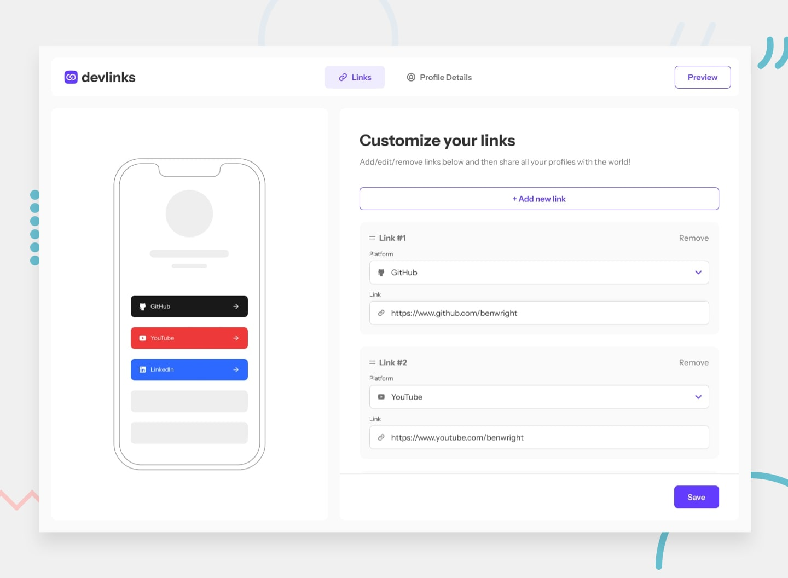

# LinkDev - a link tree for developers

Build a single page that gathers your developer profiles (GitHub, LinkedIn, dev.to, Codewars, ...) and share it with one URL.



Live demo: https://linkdev2.vercel.app

## What it does

- Sign up with email + password, or sign in with Google or GitHub (Supabase Auth, OAuth callback via `/api/auth/callback`).
- Add, edit and remove links for 13 platforms (GitHub, Frontend Mentor, Twitter, YouTube, LinkedIn, Facebook, Twitch, dev.to, Codewars, freeCodeCamp, GitLab, Hashnode, Stack Overflow), each with its brand colour.
- Edit your profile (display name, public email) and upload an avatar to Supabase Storage.
- Live phone-style preview while editing, plus a full preview page.
- Public, shareable page at `/shareable-page/<user_id>` with a one-click "copy link" button.

## Stack

- Next.js 13 (pages router), React 18, TypeScript
- Supabase: `@supabase/supabase-js`, `@supabase/auth-helpers-nextjs`, `@supabase/auth-ui-react`
- MUI 5 + Emotion, CSS Modules
- Redux Toolkit, React Hook Form + Zod
- Jest + Testing Library

## Run locally

Requires Node 22+ (tested on Node 24) and npm.

```bash
git clone https://github.com/lucaszebre/linkdev2.git
cd linkdev2
npm install
cp .env.example .env.local   # then fill in the two values below
npm run dev                  # http://localhost:3000
```

Environment variables (see `.env.example`):

| Name | Purpose |
| --- | --- |
| `NEXT_PUBLIC_SUPABASE_URL` | Your Supabase project URL |
| `NEXT_PUBLIC_SUPABASE_ANON_KEY` | Your Supabase anon (public) key |

Both are read at build time, so `npm run build` also needs them.

### Supabase setup

The database schema is not in this repo (`supabase/seed.sql` is empty). In your Supabase project you need:

- a `User` table with at least `user_id` (matches `auth.users.id`), `email`, `firstname`, `avatar_url` and a `links` JSON column;
- a public Storage bucket named `Avatar`;
- Google and GitHub OAuth providers enabled if you want social login;
- your Supabase project hostname in `images.domains` in `next.config.js` (currently set to the original project).

### Other scripts

```bash
npm run build   # production build
npm start       # serve the production build
npx jest        # run the tests once (`npm test` starts Jest in watch mode)
```

## Status

Built in 2023 as a learning project; not actively maintained. Dependencies were refreshed in October 2026 (patch/minor bumps only).
